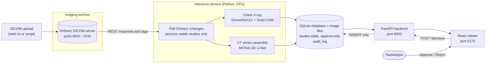
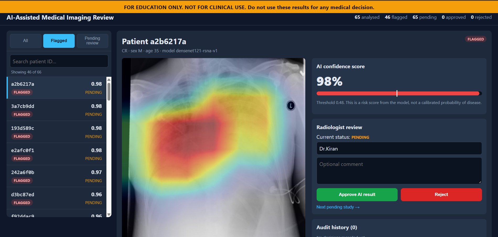
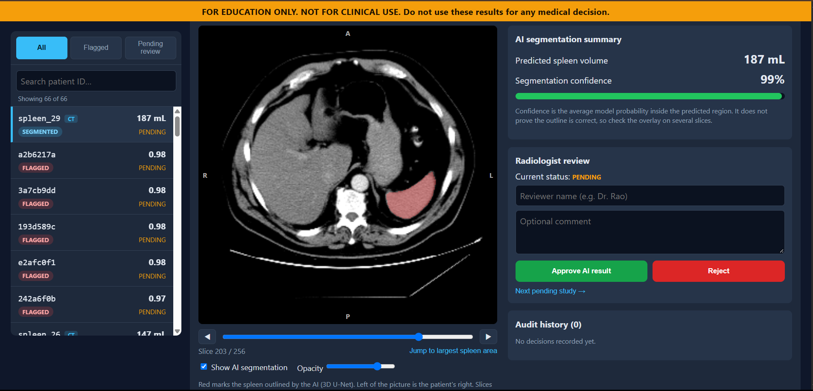
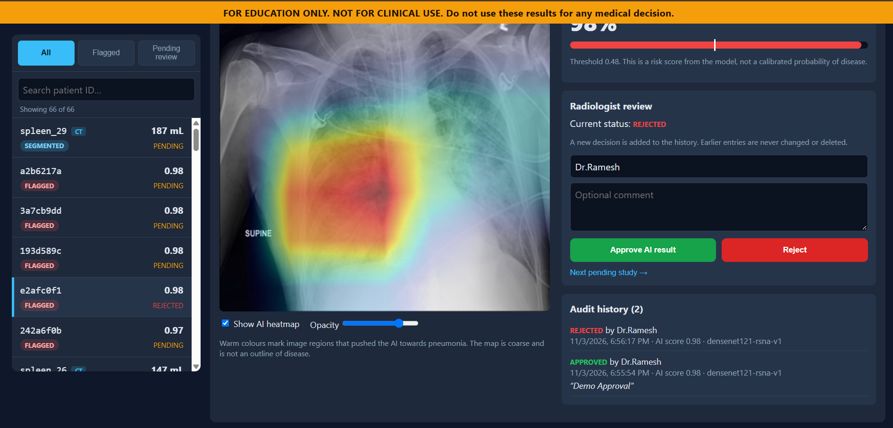
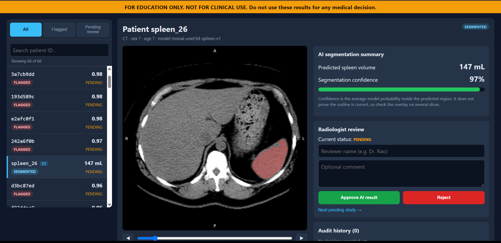

# AI-Assisted Medical Imaging and Diagnosis System

> **FOR EDUCATION ONLY. NOT FOR CLINICAL USE.**
> This is a learning project. It must not be used to diagnose, treat or make any medical decision.

A small end-to-end platform. Scans are stored in an **Orthanc DICOM server**, analysed automatically by deep-learning models, shown to a reviewer with an **explanation overlay**, and the reviewer **approves or rejects** each AI result. Every decision is written to an **append-only audit log**.

| Scan type | Task | Model | Explanation shown |
|---|---|---|---|
| Chest X-ray (CR/DX) | pneumonia screening | DenseNet121 (transfer learning, PyTorch) | Grad-CAM heatmap |
| CT, axial series | spleen segmentation | 3D U-Net (MONAI) | AI mask overlay with slice slider and volume in mL |



## Screenshots

| X-ray with Grad-CAM heatmap | CT spleen segmentation |
|---|---|
|  |  |

| Reviewer audit history | Weak CT case (97% confidence, volume 27% too small) |
|---|---|
|  |  |

## Results at a glance

| Model | Data | Result on held-out data |
|---|---|---|
| X-ray classifier | RSNA Pneumonia Detection, 4,003 test patients | AUC **0.887**, sensitivity 0.871, specificity 0.721 |
| CT spleen segmentation | MSD Task09 Spleen, 6 test volumes | Dice **0.925 ± 0.048** (worst case 0.821) |
| Grad-CAM localisation | 40 test pneumonia cases | hottest point inside the radiologists' box in 54% of detected cases (11% expected by chance) |
| DICOM path vs original NIfTI | 2 CT volumes | identical grid, Dice 0.8205 / 0.9599 (matches the training notebook) |

Full numbers, tests and caveats: [docs/TEST_RESULTS.md](docs/TEST_RESULTS.md). Limits and bias: [MODEL_CARD.md](MODEL_CARD.md).

## Quick start (Docker)

Requirements: Docker Desktop (4 GB of memory is enough), Git.

```bash
git clone https://github.com/DarshanKumarGP/ai-medical-imaging.git
cd ai-medical-imaging

# 1. Trained models (versioned with DVC). Either:
dvc pull                       # works where the DVC remote is reachable
# or copy best_model.pt and best_unet3d.pt into the models/ folder
# (they are also included in the project's submission folder).

# 2. Start everything
docker compose up -d --build   # first build takes 10-25 minutes
```

| Service | Address | Notes |
|---|---|---|
| Reviewer viewer (React) | http://localhost:5173 | |
| API and interactive docs (FastAPI) | http://localhost:8000/docs | |
| Orthanc DICOM server | http://localhost:8042 | demo login `demo` / `demo` (change via `.env`, see `.env.example`) |

The first start analyses everything already stored in Orthanc. New studies uploaded to Orthanc appear in the viewer within about 15 seconds. Stop with `docker compose down` (data is kept). `docker compose down -v` deletes all stored scans, results and the audit log.

### Demo data

The datasets are not redistributed here. Create your own demo scans:

```bash
pip install requests pydicom pandas scikit-learn kaggle
python src/make_splits.py              # needs data/raw/stage_2_train_labels.csv (Kaggle RSNA labels)
python src/download_samples.py         # 20 chest X-rays (Kaggle account + accepted competition rules)
python src/upload_to_orthanc.py        # sends every .dcm under data/raw to Orthanc
```

For CT: export two volumes from the Medical Segmentation Decathlon Task09 Spleen data, then
`python src/nifti_to_dicom.py` converts them to DICOM series and `upload_to_orthanc.upload_all('demo_files/ct')` uploads them.
You can also drag any DICOM files into the Orthanc web page (Upload).

## How it works

1. **Orthanc** stores the studies and announces a study as *stable* once uploads have stopped.
2. The **inference service** (`src/inference_service.py`) watches Orthanc. X-rays go to DenseNet121 + Grad-CAM. CT series are assembled into a 3D volume, resampled and segmented by the 3D U-Net. A CT with fewer than 30 slices, uneven spacing or a non-axial orientation is **skipped with a stated reason** instead of producing a wrong result.
3. Results go to SQLite plus image files. The heatmap is stored only for flagged X-rays, because a heatmap on a normal-scored scan would mislead.
4. The **FastAPI backend** serves studies, images and CT slices and records decisions.
5. The **React viewer** shows scan + overlay, the AI score (X-ray) or volume (CT), and Approve/Reject buttons. Decisions are inserted into `audit_log` with reviewer name, AI score, model version and UTC time. Database triggers refuse any update or delete of audit entries, and the API has no endpoint for them.

## Repository layout

```
src/            data prep, training helpers, Grad-CAM, inference service, FastAPI backend, CT helpers
tests/          pytest suite (23 tests)
notebooks/      Colab training notebooks (classification, segmentation)
frontend/       React viewer (Vite)
docker/         Dockerfiles and requirement generator
models/         trained weights, tracked by DVC (*.dvc pointers in Git)
data.dvc        DVC pointer for the versioned sample data and splits
docs/           architecture, test results, screenshots, metrics
```

## Tests

```bash
pip install pytest httpx fastapi numpy pillow
pytest -q                     # 23 passed
cd frontend && npm ci && npm run lint && npm run build
```

## Data versioning (DVC)

`data.dvc` and `models/*.dvc` record content hashes of the sample data, split files and trained weights. The DVC remote in this repository is a local folder, so `dvc pull` only works on the author's machine. For any other machine use the copies in the submission folder.

## Safety, privacy and limits

- Not a medical device. A clear notice is shown at the top of the viewer at all times.
- Public research data only. The patient names and IDs in the demo are random identifiers.
- The X-ray score is a **risk score**, not a calibrated probability. CT "confidence" is the average model probability inside the mask and does not prove the outline is right (example: one test CT scored 97% while the volume was 27% too small).
- Reviewer names are typed in. A real system needs authentication so each audit entry is tied to a verified account.
- See [MODEL_CARD.md](MODEL_CARD.md) for dataset limits, label noise, subgroup results and failure examples.

## Data and credits

- RSNA Pneumonia Detection Challenge (RSNA / Kaggle). Competition rules apply.
- Medical Segmentation Decathlon, Task09 Spleen (CC-BY-SA 4.0).
- Built with PyTorch, MONAI, pytorch-grad-cam, Orthanc, FastAPI, React, DVC and Docker.