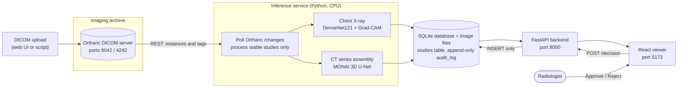

# Architecture and API notes

## Components

| Component | Technology | Responsibility |
|---|---|---|
| Orthanc | `orthancteam/orthanc`, ports 8042 (REST/UI), 4242 (DICOM) | Stores DICOM studies, exposes `/changes` with `StableStudy` events and `IsStable` flags |
| Inference service | Python 3.11, PyTorch (CPU), MONAI, pytorch-grad-cam | Finds new stable studies, runs the right model, writes results |
| Database | SQLite (WAL mode) in a Docker volume shared with the API | `studies`, `audit_log` (append-only), `state` |
| Backend | FastAPI + Uvicorn | Read API for studies/images/slices, write API for decisions |
| Viewer | React + Vite, served by nginx | Review workflow |

## Study life cycle

1. A DICOM instance is uploaded to Orthanc. After 5 seconds without new instances the study is *stable*.
2. The service lists new stable studies (via `/changes`, plus a safety net over `/studies` that only accepts studies with `IsStable = true`, so a half-uploaded CT series is never analysed early).
3. By modality:
   - **CR/DX**: read the DICOM, normalise, resize to 224x224, DenseNet121 score, Grad-CAM on the last DenseNet block. Flagged if score >= 0.4837 (threshold chosen on the validation set). A transparent heatmap PNG is stored only when flagged.
   - **CT**: download all slices, keep the largest series, check it (>= 30 slices, axial, regular spacing), rebuild the 3D volume and RAS affine from the DICOM geometry, apply the same orientation, resampling (1.5 x 1.5 x 2.0 mm), intensity window (-57..164 HU) and foreground crop as in training, run sliding-window 3D U-Net inference, store CT and mask arrays, volume in mL and the slice with the largest area.
   - anything else, or an unsuitable CT: stored as `skipped` with a reason.
   - unexpected failures: stored as `error` with a one-line root cause; the full traceback goes to the service log.
4. The viewer polls the API every 10 seconds. A reviewer approves or rejects; the API writes the audit entry and the new review status in **one transaction**.

## Database tables

`studies`: one row per Orthanc study (status, modality, score, flag and threshold for X-rays, volume, slice count and best slice for CT, model version, review status, file references).

`audit_log`: `id, study_id, reviewer, decision, comment, ai_score, flagged, model_version, created_at (UTC)`.
SQLite triggers `audit_no_update` and `audit_no_delete` abort any `UPDATE` or `DELETE`. Re-reviewing a study adds a new row, so the full history is kept.

## API summary (live, interactive version at `/docs`)

| Method and path | Purpose |
|---|---|
| `GET /health` | liveness and disclaimer |
| `GET /studies` | list, sorted by score; filters `review_status`, `flagged`, paging |
| `GET /studies/{id}` | one study with its audit history |
| `GET /studies/{id}/scan`, `/heatmap` | X-ray image and Grad-CAM overlay (PNG, cached 1 h) |
| `GET /studies/{id}/slice/{z}/scan`, `/mask` | one CT slice and its AI mask overlay (PNG, radiological orientation) |
| `POST /studies/{id}/decision` | body `{reviewer, decision: approved or rejected, comment?}`; returns the audit entry; 409 for skipped or failed studies |
| `GET /audit` | read-only audit history, optional `study_id` |
| `GET /stats` | counters for the viewer's header |

There is deliberately no endpoint that edits or deletes audit entries (`PUT` and `DELETE` return 405).

## Design decisions worth explaining

- **Heatmap only for flagged scans.** Grad-CAM rescales every map to 0-1, so a "normal" scan would still get a red region.
- **Split by patient, never by image.** Patients with several boxes cannot leak between train, validation and test.
- **Threshold chosen on validation, reported on test.** The test set was used once.
- **CT validated end to end.** The DICOM path is compared against the original NIfTI files (identical grid, same Dice as the notebook).
- **Models mounted, not baked into the images.** They are DVC-versioned artefacts.
